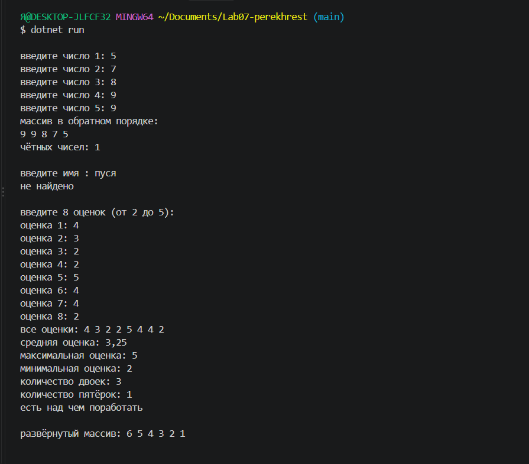
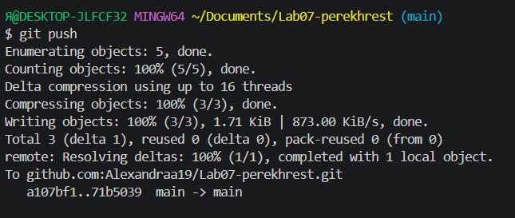

# Практическая работа №7

**ФИО:** Перехрест Александра
**Группа:** исп-242
**Дата:** 2026-10-15

## Что изучено

- Индексация массива начинается с нуля, последний элемент имеет индекс `Length - 1`.
- `foreach` удобен, когда нужны только значения, а для изменения элементов обязательно нужен `for` с индексом.
- Типовые задачи над массивом (сумма, среднее, минимум, максимум, подсчёт по условию) решаются накоплением в переменной во время перебора.

## Скриншоты

